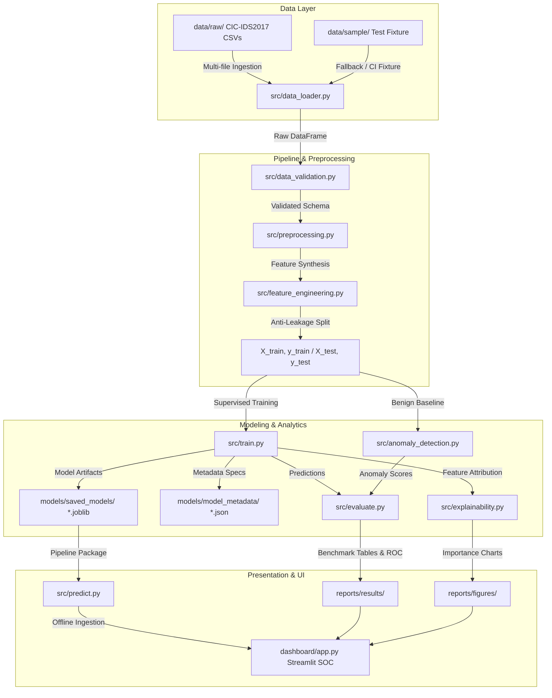

# System Architecture Specification

## 1. High-Level Architecture Overview
The **CyberPulse Intelligent Threat Detection Platform** is structured as an end-to-end, modular, offline cybersecurity analytics system. The architecture separates raw data ingestion, stateful preprocessing, ML modeling, diagnostic evaluation, explainability, and user interfaces into decoupled components.

---

## 2. Module Responsibilities & Contracts

| Module | Primary Contract | Key Dependencies |
| :--- | :--- | :--- |
| `src/config.py` | Singleton configuration provider loading `config.yaml` with path resolution. | `PyYAML`, `pathlib` |
| `src/data_loader.py` | Multi-file CSV ingestion, header trimming, chunking, and software fixture generation. | `pandas`, `numpy` |
| `src/data_validation.py` | Schema compliance checks, upload size limits, and feature compatibility alignment. | `pandas` |
| `src/preprocessing.py` | Stateful `NetworkDataPreprocessor` (median imputation, scaling, constant filter). | `scikit-learn` |
| `src/feature_engineering.py` | Forward/backward asymmetry, control flag counts, collinearity detection. | `numpy`, `pandas` |
| `src/train.py` | Calibrated algorithm builders, stratified cross-validation, and pipeline persistence. | `scikit-learn`, `xgboost`, `joblib` |
| `src/evaluate.py` | Diagnostic metrics (Accuracy, Precision, Recall, Macro-F1, FPR, FNR, ROC-AUC, latency). | `scikit-learn` |
| `src/anomaly_detection.py` | Unsupervised `NetworkAnomalyDetector` using Isolation Forest on normal baseline. | `scikit-learn` |
| `src/explainability.py` | Tree Gini MDI, holdout permutation importance, and causal disclaimers. | `scikit-learn`, `shap` |
| `src/predict.py` | Batch CSV inference pipeline with confidence scoring and risk tiering. | `joblib`, `pandas` |
| `dashboard/app.py` | Interactive Security Operations Center (SOC) dashboard. | `streamlit`, `plotly` |

---

## 3. Data Leakage Isolation Boundary
All stateful mathematical transformations adhere to strict directional constraints:
- **Learned on Training Split Only:**
  - Imputation medians ($\tilde{x}_j$)
  - Standard scaling parameters ($\mu_j, \sigma_j$)
  - Quantile outlier clipping bounds ($q_{0.001}, q_{0.999}$)
  - Constant column variance thresholds
  - LabelEncoder mappings
- **Applied to Test & Production Holds:**
  - `transform(X_test)` strictly uses pre-computed parameters without calling `fit()`.

---

## 4. Pipeline Serialization Artifact Specification
Trained models are packaged using `joblib` into unified self-contained objects containing:
1. `model`: The trained Scikit-Learn or XGBoost estimator instance.
2. `preprocessor`: The fitted `NetworkDataPreprocessor` with learned scaling and imputation parameters.
3. `model_name`: String identifier of the algorithm.
4. `target_mode`: `'binary'` or `'multiclass'`.
5. `features`: Ordered list of expected input column names.
6. `classes`: Ordered list of target class strings.
7. `trained_at`: ISO 8601 UTC timestamp.

